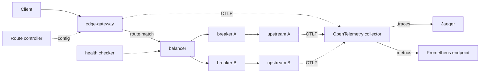

# edge-gateway

A small API gateway and reverse proxy written in Go, deployed to Kubernetes with Helm and provisioned with Terraform.

I built it to practice production-grade Go, Kubernetes platform tooling, and infrastructure as code in one project that I can run end to end.

> **Status:** `v0.4.0` implementation is complete. The local demo is verified;
> GitHub release notes and the paid cloud demo remain pending.

Built with AI coding assistants. See [how this was built](docs/how-this-was-built.md).

## Features

| Feature | Status |
|---|---|
| Path-prefix routing to multiple upstreams | done |
| Round-robin load balancing | done |
| Active health checks | done |
| Token-bucket rate limiting (per client IP; see limitations) | done |
| Circuit breaker | done |
| Atomic hot config reload | done |
| OpenTelemetry traces and metrics | done |
| Helm chart (probes, autoscaler, disruption budget) | done |
| `Route` custom resource and controller | done |
| Terraform local and Exoscale modules | done |

## Architecture



The `Route` controller aggregates resources into the gateway ConfigMap. Mounted
ConfigMap updates can take up to about a minute to reach each pod; the gateway
then validates and atomically applies the new runtime.

## Quick start

Requirements: Go (version in `go.mod`). For the cluster demo also Docker,
[kind](https://kind.sigs.k8s.io/), kubectl and Helm. The chart needs
Kubernetes 1.30 or newer (native `preStop` sleep).

```bash
make test      # unit tests with the race detector
make run       # run the gateway on :8080 (single upstream via flags)
make up        # kind cluster + images + gateway, demo upstreams, Jaeger, collector
make down      # delete the kind cluster
```

After `make up`:

```bash
curl localhost:8080/api/users/hello    # served by echo-users via the gateway
curl localhost:8080/api/orders/hello   # served by echo-orders
kubectl -n edge apply -f examples/route.yaml
kubectl -n edge get routes
curl localhost:8080/api/users/hello    # now served from the Route aggregate
```

To run the binary against a config file:

```bash
go run ./cmd/gateway -config gateway.yaml
```

Without `-config`, `-listen` and `-upstream` set up a single catch-all route.
`SIGINT` and `SIGTERM` drain in-flight requests before exiting.

## Configuration

```yaml
listen: ":8080"
routes:
  - prefix: /api/users
    upstreams:
      - http://users-1:9000
      - http://users-2:9000
    rate_limit:
      requests_per_second: 50
      burst: 100
  - prefix: /
    upstreams:
      - http://web:8000
health:            # optional, these are the defaults
  path: /health
  interval: 5s
  timeout: 2s
circuit_breaker:   # optional, these are the defaults
  failure_threshold: 5
  open_timeout: 30s
  half_open_requests: 1
```

- The longest matching prefix wins, on path-segment boundaries: `/api` matches
  `/api` and `/api/x`, not `/apiary`. Unmatched requests get `404`.
- Request paths are cleaned (`/a/../b` becomes `/b`) before matching and
  forwarding.
- Upstreams are served round-robin. One that fails its health check (non-2xx
  or unreachable) leaves the rotation until it passes again. With none
  healthy the gateway returns `503`.
- Connection errors, timeouts, and 5xx responses open an upstream's circuit
  after the configured consecutive failure threshold. Open circuits are
  skipped; after the timeout, limited trial traffic tests recovery.
- Over-limit requests get `429` with a `Retry-After` header. Limits are per
  client IP and per route.

## Design decisions

Short notes on the choices that matter, each with the alternatives I considered.

- [001: Why a token bucket for rate limiting](docs/decisions/001-rate-limiting.md)
- [002: Health checks, active versus passive](docs/decisions/002-health-checks.md)
- [003: ConfigMap aggregation for Routes](docs/decisions/003-controller.md)
- [004: Passive circuit breaking](docs/decisions/004-circuit-breaker.md)

## Kubernetes

The Helm chart in [deploy/helm/gateway](deploy/helm/gateway) deploys the
gateway with:

- **Probes.** Liveness hits `/healthz` (the process is alive). Readiness hits
  `/readyz`, which is `200` only while at least one upstream is healthy and the
  pod is not shutting down. Liveness deliberately ignores upstream health, so a
  backend outage does not restart the gateway. See
  [decision 002](docs/decisions/002-health-checks.md).
- **Circuit breaking.** Each upstream has an independent breaker. Request
  failures open the circuit before the next active health probe, and a bounded
  half-open trial set tests recovery. Breakers reset when the gateway runtime
  is reloaded. See [decision 004](docs/decisions/004-circuit-breaker.md).
- **Config.** The gateway config lives in a ConfigMap (`values.yaml`, key
  `config`). A checksum annotation rolls the pods for Helm-rendered config
  changes. Controller-written changes are picked up live from the mounted
  directory. Invalid updates leave the last good router and health checker in
  place.
- **Route controller.** The chart installs the `Route` CRD, controller
  Deployment, ServiceAccount and RBAC. The controller lists all Routes in a
  namespace and writes one deterministic ConfigMap entry. `Ready` and
  `Conflict` conditions show which Routes are active. See
  [decision 003](docs/decisions/003-controller.md).
- **Hardening.** Non-root user, read-only root filesystem, all capabilities
  dropped, `RuntimeDefault` seccomp, no service account token. The image is
  distroless and multi-stage built (`docker build .`): **31 MB** as Docker reports it (7.1 MB compressed), runs as
  uid 65532.
- **Availability.** A CPU-based HorizontalPodAutoscaler (2 to 5 replicas), a
  PodDisruptionBudget (`minAvailable: 1`), pods spread across nodes, and a
  rolling update with `maxUnavailable: 0` and `maxSurge: 1`.
- **Graceful termination.** On pod deletion the kubelet runs a `preStop` sleep
  (5s) while the endpoint removal propagates, then sends `SIGTERM`. The gateway
  flips `/readyz` to `503` and drains in-flight requests for up to 30s.
  `terminationGracePeriodSeconds` is `5 + 30 + 10 = 45`.

Chart checks run in CI (`helm lint` and `helm template`), as does building all
three images. Locally: `make helm-check`.

```bash
helm install gateway deploy/helm/gateway \
  --set 'config.routes[0].prefix=/' \
  --set 'config.routes[0].upstreams[0]=http://my-service:8080'
```

`make up` uses [deploy/kind/gateway-values.yaml](deploy/kind/gateway-values.yaml)
to route `/api/users` and `/api/orders` to two demo echo services, and installs
metrics-server so the autoscaler has data.

Helm installs CRDs from `crds/` only on the initial install; Helm does not
upgrade them. Before a chart upgrade that changes the Route schema, apply the
generated CRD explicitly:

```bash
kubectl apply -f deploy/helm/gateway/crds/routes.gateway.gateway.local.yaml
```

The chart can be upgraded after the CRD. The committed CRD is generated from
`controller/api/v1alpha1/route_types.go` and copied into the chart with
`make controller-manifests`.

The Route example changes the mounted aggregate without restarting the
gateway:

```bash
kubectl -n edge apply -f examples/route.yaml
kubectl -n edge get routes
curl localhost:8080/api/users/hello
```

ConfigMap projection is eventually consistent, so allow up to about a minute
between applying a Route and observing a live routing change.

Verified on the 2026-11-25 Codespace kind demo (Kubernetes 1.37):

```text
$ kubectl -n edge get routes
NAME    PREFIX       READY
users   /api/users   True

$ curl localhost:8080/api/users/demo
{"service":"users", ... "path":"/api/users/demo" ...}

# Edit the Route from echo-users /api/users to echo-orders /api/orders.
$ curl -w '%{http_code}' localhost:8080/api/orders/live
200
$ curl -w '%{http_code}' localhost:8080/api/users/live
404
```

Both gateway pod UIDs were unchanged, so the second curl result came from hot
reload rather than a rollout.

## Terraform

The Helm release is reusable through [terraform/modules/gateway](terraform/modules/gateway).
For a fresh local kind cluster, build and load the three images with
`make cluster images`, then use:

```bash
cd terraform/environments/local
terraform init
terraform plan
terraform apply
curl http://localhost:8080/api/users/hello
```

The local environment applies the demo upstreams and observability manifests,
then installs the gateway chart and controller. Its kubeconfig path and kind
context can be overridden with Terraform variables. Use one installation
method per cluster: resources already created by `make up` are not imported
into Terraform state, so applying Terraform over that installation will try to
create conflicting resources.

The paid demo in [terraform/environments/demo](terraform/environments/demo)
creates a one-node Exoscale SKS cluster and installs the same Helm chart. Set
`EXOSCALE_API_KEY` and `EXOSCALE_API_SECRET`, supply pullable gateway and
controller image repositories, and initialize its SOS-compatible S3 backend
from `backend.hcl.example`. State locking uses the S3 lockfile, so the backend
bucket must permit get, put, and delete for the state key plus its `.tflock`
object. Backend credentials and Exoscale credentials stay in environment
variables; no credential file is committed. The demo's state still contains the
short-lived admin kubeconfig: the output is marked sensitive, which hides it from
plan output but not from state. Keep the state bucket private.

## Observability

The gateway and the demo echo services export traces and metrics over OTLP/HTTP
to an OpenTelemetry Collector (set `otel.endpoint` in the chart, or
`OTEL_EXPORTER_OTLP_ENDPOINT` for the binary). Without an endpoint,
instrumentation is a no-op. The collector sends traces to Jaeger and exposes
metrics in Prometheus format. `make up` deploys all three
([deploy/observability.yaml](deploy/observability.yaml)).

### Traces

The gateway wraps its handler with `otelhttp` and wraps the upstream transport
with `otelhttp.NewTransport`, so W3C `traceparent` reaches the upstream. One
request produces one trace across both services:

```bash
kubectl -n edge port-forward svc/jaeger 16686:16686
# Open localhost:16686, or use VS Code's Ports tab in Codespaces.
curl localhost:8080/api/users/hello                   # the response includes "trace_id"
```

The trace for that request, as returned by the Jaeger API:

```text
gateway      GET                 (server span, route /api/users)
└─ gateway   HTTP GET            (client span to the upstream)
   └─ echo-users   GET /         (server span in the upstream)
```

All three spans share one trace ID, which is also the `trace_id` echoed in the
JSON response body.

### Metrics

| Metric | Labels | Meaning |
|---|---|---|
| `gateway_requests_total` | `http_route`, `http_response_status_code` | Requests handled |
| `gateway_request_duration_seconds` | same | Latency histogram |
| `gateway_ratelimited_total` | `http_route` | Requests rejected with 429 |
| `gateway_upstreams_healthy` | `http_route` | Upstreams in rotation |
| `gateway_upstreams_breaker` | `http_route`, `upstream`, `circuit_breaker_state` | Current circuit state for each upstream |

Requests that match no route are recorded under `http_route="unmatched"`.
`gateway_upstreams_healthy` counts the upstream URLs of a route that are in
rotation. In the kind demo each route has one upstream (a Service), so it is
`1` or `0` per pod. Each pod reports its own series (label `instance`), so sum
across pods. Metrics export every 10s (`otel.metricExportIntervalMs`, an
integer in milliseconds as the OpenTelemetry spec requires).

```bash
kubectl -n edge port-forward svc/otel-collector 8889:8889
curl -s localhost:8889/metrics | grep '^gateway_'
```

In GitHub Codespaces, open the forwarded ports from the VS Code **Ports** tab.
Codespaces serves them as
`https://<codespace-name>-<port>.app.github.dev`; use the same GitHub browser
session if the generated URL is private.

### Killing an upstream

Load of 50 requests/s on `/api/users` (one worker at 50 qps), then `kubectl scale deploy/echo-users
--replicas=0`, then back to 2. Values are summed over the 2 gateway pods from
the collector's `/metrics`; counters are cumulative since the pods started.

| Time | `gateway_upstreams_healthy` (`/api/users`) | Requests | 5xx |
|---|---|---|---|
| 14s, baseline | 2 | 22530 | 6876 |
| 36s, upstream down | **0** | 23531 | 7088 |
| 62s, recovered | 2 | 25029 | 8187 |

Each gateway pod exports its gauge every 10 seconds, so a sample can lag the
health check by up to one export interval. Sampling each pod every 4 seconds in
a separate run, the gauge reached `0` 5 to 9 seconds after the scale-down, and
returned to `1` on each pod 9 to 13 seconds after the scale-up.

The load generator sent 50 requests/s for 75 seconds and saw 2438 `200`, 5
`502` (requests that raced the health check) and 1306 `503`. The 5xx counter
rose by about 1100 between 36s and 62s, which covers the outage, so most of the
load failed while the upstream was down. Requests and 5xx are counters since the
gateway pods started, so compare the rows rather than the absolute values.

The rate limiter is visible the same way. A burst of 6000 requests against
`/api/orders` (limit 200 rps and burst 400 per pod, 20 concurrent connections)
returned 2250 `200` and 3750 `429`. The `gateway_ratelimited_total` counter for
that route rose by 3750 over the same run. The limit applies per pod, so with
two pods the burst allowance is roughly doubled.

*Screenshots are not included; the output tables come from a live cluster.
The most important visual for tracing is the Jaeger request trace, and the
Prometheus endpoint provides the metric evidence.*

## Testing and benchmarks

- Unit tests run with `go test -race ./...`
- Benchmarks: `go test -run '^$' -bench . -benchmem ./internal/proxy/`

| Benchmark | Result |
|---|---|
| `BenchmarkProxy` (route match, balancer, reverse proxy, loopback upstream, parallel) | ~93 µs/op (five runs: 87 to 102), 46.5 KB/op, 111 allocs/op |

Measured on an Intel i7-4770HQ (8 threads), macOS (darwin/amd64), Go 1.27.4,
with `-count 5`. The benchmark calls the handler directly, so it excludes the
client-to-gateway network hop.

### Zero-downtime rollout

`make rollout-test` sends steady load through the gateway while it does a
rolling restart, and fails on any non-200 response or transport error. It uses
[hey](https://github.com/rakyll/hey) and the kind cluster from `make up`.

| | |
|---|---|
| Load | 10 workers x 10 qps for 60s against `/api/users/...` via `localhost:8080` |
| Event | `kubectl rollout restart deployment/gateway` 5s in (2 replicas, `maxUnavailable: 0`) |
| Result | **6,000 requests, all `200`, 0 errors** |
| Latency | p50 6.9 ms, p99 25.3 ms, max 68 ms |

The settings that make this work are the readiness probe, the `preStop` sleep,
the drain-on-`SIGTERM` behavior and the grace period; see
[Kubernetes](#kubernetes). It is one run on a single-node kind cluster (server
Kubernetes v1.37.0) on the same laptop as the benchmark, so treat it as evidence
the mechanism works, not as a capacity claim.

## Limitations and what I would do next

- TLS is not terminated by the gateway yet. A production deployment should
  add certificate management at an ingress or gateway layer.
- The `Route` controller watches one namespace and the CRD has no
  cross-namespace ownership model.
- There is no authentication or authorization on proxied traffic. A production
  version needs identity-aware policies and bounded access to administrative
  surfaces.
- Circuit breaker state is in-memory per pod. Sharing failure state across
  replicas would require a distributed decision and would be less responsive to
  pod-local failures.
- The Terraform environment provisions a small SKS demo, not a
  multi-environment production platform. Production use would add private
  ingress, network policy, secrets management, backup policy, cost controls,
  and separate state per environment.
- Rate limiting is keyed on the connection's peer address. Behind an ingress or
  load balancer, all clients share one bucket until trusted-proxy handling
  lands ([issue #9](https://github.com/skhurram/gateway/issues/9)).
- The `Route` controller and the Helm chart write the same ConfigMap. A
  `helm upgrade` replaces Route-generated routes with the chart's values, and
  the controller does not reconcile until the next Route change. Once any Route
  exists, routes declared in the chart values are dropped.
- Open issues and known findings are listed in the
  [issue tracker](https://github.com/skhurram/gateway/issues).

## Roadmap

- [x] v0.1: proxy, routing, round-robin, health checks, rate limiting
- [x] v0.2: Helm chart, OpenTelemetry, kind demo
- [x] v0.3: `Route` controller and atomic hot reload
- [x] v0.4: Terraform modules and circuit breaker (`v0.4.0` tag; GitHub
  release notes and paid cloud demo pending)

## License

MIT
