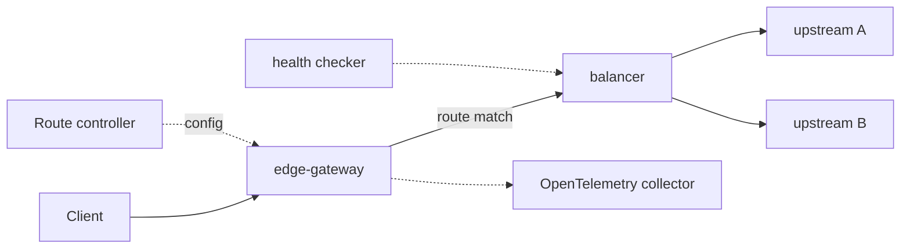

# edge-gateway

A small API gateway and reverse proxy written in Go, deployed to Kubernetes with Helm and provisioned with Terraform.

I built it to practice production-grade Go, Kubernetes platform tooling, and infrastructure as code in one project that I can run end to end.

> **Status:** in progress. See [Roadmap](#roadmap) for what works today.

## Features

| Feature | Status |
|---|---|
| Path-prefix routing to multiple upstreams | done |
| Round-robin load balancing | done |
| Active health checks | done |
| Token-bucket rate limiting (per client IP) | done |
| Circuit breaker | planned |
| Hot config reload | planned |
| OpenTelemetry traces and metrics | planned |
| Helm chart (probes, autoscaler, disruption budget) | planned |
| `Route` custom resource and controller | planned |
| Terraform cluster module | planned |

## Architecture



*Replace this with a final diagram once the controller and telemetry exist.*

## Quick start

Requirements: Go (version in `go.mod`).

```bash
make test      # unit tests with the race detector
make run       # run the gateway on :8080 (single upstream via flags)
```

`make up` and `make down` (kind cluster and Helm deploy) arrive in v0.2.

To run the binary against a config file:

```bash
go run ./cmd/gateway -config gateway.yaml
```

Without `-config`, `-listen` and `-upstream` set up a single catch-all route.
`SIGINT` and `SIGTERM` drain in-flight requests before exiting.

## Configuration

```yaml
listen: ":8080"
routes:
  - prefix: /api/users
    upstreams:
      - http://users-1:9000
      - http://users-2:9000
    rate_limit:
      requests_per_second: 50
      burst: 100
  - prefix: /
    upstreams:
      - http://web:8000
health:            # optional, these are the defaults
  path: /health
  interval: 5s
  timeout: 2s
```

- The longest matching prefix wins, on path-segment boundaries: `/api` matches
  `/api` and `/api/x`, not `/apiary`. Unmatched requests get `404`.
- Request paths are cleaned (`/a/../b` becomes `/b`) before matching and
  forwarding.
- Upstreams are served round-robin. One that fails its health check (non-2xx
  or unreachable) leaves the rotation until it passes again. With none
  healthy the gateway returns `503`.
- Over-limit requests get `429` with a `Retry-After` header. Limits are per
  client IP and per route.

## Design decisions

Short notes on the choices that matter, each with the alternatives I considered.

- [001: Why a token bucket for rate limiting](docs/decisions/001-rate-limiting.md)
- 002: Health checks, active versus passive (planned)
- 003: Controller versus config file (planned)

## Kubernetes

*Describe the Helm chart: probes, autoscaling, disruption budget, and how the `Route` resource is reconciled.*

## Terraform

*Describe the cluster module, remote state, and how to plan and apply the demo environment.*

## Observability

*Show an example trace and the metrics the gateway exposes.*

## Testing and benchmarks

- Unit tests run with `go test -race ./...`
- Benchmarks: `go test -run '^$' -bench . -benchmem ./internal/proxy/`

| Benchmark | Result |
|---|---|
| `BenchmarkProxy` (route match, balancer, reverse proxy, loopback upstream, parallel) | ~47 µs/op, 46 KB/op, 104 allocs/op |

Measured on an Intel i7-4770HQ (8 threads), macOS, Go 1.27. The benchmark
calls the handler directly, so it excludes the client-to-gateway network hop.

## Roadmap

- [x] v0.1: proxy, routing, round-robin, health checks, rate limiting
- [ ] v0.2: Helm chart, OpenTelemetry, kind demo
- [ ] v0.3: `Route` controller
- [ ] v0.4: Terraform module, circuit breaker, hot reload

## License

MIT
