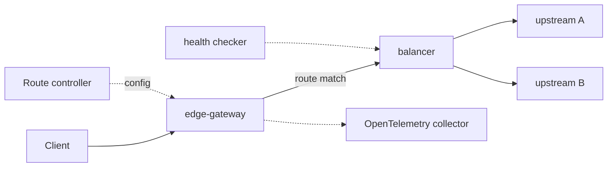

# edge-gateway

A small API gateway and reverse proxy written in Go, deployed to Kubernetes with Helm and provisioned with Terraform.

I built it to practice production-grade Go, Kubernetes platform tooling, and infrastructure as code in one project that I can run end to end.

> **Status:** in progress. See [Roadmap](#roadmap) for what works today.

## Features

| Feature | Status |
|---|---|
| Path-prefix routing to multiple upstreams | planned |
| Round-robin load balancing | planned |
| Active health checks | planned |
| Token-bucket rate limiting (per client IP) | planned |
| Circuit breaker | planned |
| Hot config reload | planned |
| OpenTelemetry traces and metrics | planned |
| Helm chart (probes, autoscaler, disruption budget) | planned |
| `Route` custom resource and controller | planned |
| Terraform cluster module | planned |

## Architecture



*Replace this with a final diagram once the controller and telemetry exist.*

## Quick start

Requirements: Go, Docker, kind, kubectl, Helm.

```bash
make up        # create a kind cluster and deploy the gateway
make test      # unit tests with the race detector
make down      # tear everything down
```

## Configuration

```yaml
listen: ":8080"
routes:
  - prefix: /api/users
    upstreams:
      - http://users-1:9000
      - http://users-2:9000
    rate_limit:
      requests_per_second: 50
      burst: 100
```

## Design decisions

Short notes on the choices that matter, each with the alternatives I considered.

- [001: Why a token bucket for rate limiting](docs/decisions/001-rate-limiting.md)
- [002: Health checks, active versus passive](docs/decisions/002-health-checks.md)
- [003: Controller versus config file](docs/decisions/003-controller.md)

## Kubernetes

*Describe the Helm chart: probes, autoscaling, disruption budget, and how the `Route` resource is reconciled.*

## Terraform

*Describe the cluster module, remote state, and how to plan and apply the demo environment.*

## Observability

*Show an example trace and the metrics the gateway exposes.*

## Testing and benchmarks

- Unit tests run with `go test -race ./...`
- Benchmarks: *add results and the machine they ran on*

## Roadmap

- [ ] v0.1: proxy, routing, round-robin, health checks, rate limiting
- [ ] v0.2: Helm chart, OpenTelemetry, kind demo
- [ ] v0.3: `Route` controller
- [ ] v0.4: Terraform module, circuit breaker, hot reload

## License

MIT
